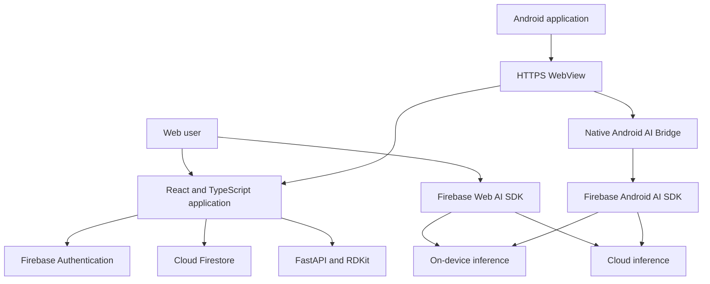

<div align="center">


# El-Kīmiyā

**Understand Chemistry. Anywhere.**

A Hybrid AI chemistry learning platform for Web and Android.

[Bahasa Indonesia](README.md) | **English**

[](https://el-kimiya.vercel.app/)
[](https://firebase.google.com/)

[](LICENSE)

**[Live application](https://el-kimiya.vercel.app/) · [Screenshot gallery](docs/screenshots/README.md) · [Android guide](android/README.md)**

</div>

---

## About

El-Kīmiyā is a chemistry-first educational platform combining bilingual learning materials, an interactive AI tutor, element exploration, molecular visualization, structured practice, and educational content management.

Its purpose is to help learners understand chemistry through explanation and exploration rather than memorization alone.

## Motivation

Chemistry learners often face abstract molecular concepts, fragmented learning resources, and inconsistent internet access.

El-Kīmiyā addresses these challenges with an integrated learning workspace powered by Firebase AI Logic Hybrid Inference, supporting local and cloud execution according to device capabilities and user preferences.

## Main features

| Feature | Description |
|---|---|
| AI Chemistry Tutor | Interactive chemistry explanations with mathematical notation. |
| Hybrid AI Engine | Local/cloud inference preferences and actual SDK-reported provider verification. |
| My Library | 13 original bilingual lessons and supplementary published content. |
| Book Reader | Learning materials and user-selected private PDF documents. |
| Scan | Image-based learning workflows. |
| Chemistry Explorer | Interactive exploration of all 118 chemical elements. |
| Molecular Intelligence Lab | Visual molecule construction, RDKit validation, and 2D/3D visualization. |
| Practice Lab | 1,152 structured numerical variants across 12 competencies with answer checking. |
| Flashcards | Chemistry review and recall activities. |
| Research Mission | Guided scientific exploration. |
| Chemistry & Faith | Contextual learning with scientific explanations distinguished from religious reflection. |
| Learning Progress | Learning activity tracking and saved notes. |
| Moduler Studio | Management of lessons, questions, flashcards, references, molecules, and supplementary tutor guidance. |

## Firebase AI Logic Hybrid Inference

The platform provides four inference preferences:

1. Prefer on-device.
2. On-device only.
3. Prefer cloud.
4. Cloud only.

The Web application uses the Firebase Web SDK. Android AI requests are transported from the WebView into the native Firebase Android AI SDK through a dedicated message bridge.

Actual SDK responses identify their inference source:

- `ON_DEVICE`: execution on the device.
- `IN_CLOUD`: execution in the cloud.

The interactive routing scenario is explicitly a simulation and must not be confused with live inference.

Local execution requires a compatible device and an available model. On-device-only requests must not silently fall back to cloud execution.

### Live inference evidence

- [Web cloud verification and tutor response](docs/screenshots/README.md#web)
- [Android on-device inference](docs/screenshots/android/06-hybrid-on-device-verification.png)
- [Android on-device tutor response](docs/screenshots/android/07-ai-tutor-on-device-response.png)
- [Android cloud inference](docs/screenshots/android/08-hybrid-cloud-verification.png)
- [Android cloud tutor response](docs/screenshots/android/09-ai-tutor-cloud-response.png)

## Android experience

<div align="center">


</div>

See the [complete Web and Android screenshot gallery](docs/screenshots/README.md).

## User roles

### Learner

Accesses lessons, AI tutoring, scientific exploration, practice, flashcards, notes, and learning progress.

### Moduler

Creates and manages bilingual supplementary educational content. Published lessons become available in the Learner workspace.

Moduler tutor guidance supplements learning instructions; it does not retrain the AI model or change the inference model.

Firebase Authentication and Firestore Security Rules enforce access to protected database content. Trusted Firebase project administrators assign Moduler roles.

## System architecture



Firebase App Check helps protect access to Firebase services.

## Technology stack

- React, TypeScript, Vite, Tailwind CSS.
- Firebase AI Logic, Authentication, Firestore, App Check.
- Kotlin, Jetpack Compose, Android WebView.
- Python, FastAPI, RDKit.
- PDF.js, Markdown, KaTeX.
- Vercel web deployment.

## Local Web development

Requirements: Git, Node.js 22.13+ or 24, npm.

```powershell
git clone https://github.com/MENSTRUE/el-kimiya.git
cd el-kimiya

npm ci
Copy-Item .env.example .env

npm run dev
```

Populate `.env` with your own Firebase Web configuration before testing authentication and live AI requests.

Build verification:

```powershell
npm run typecheck
npm run build
npm run preview
```

The public RDKit endpoint is implemented as a Vercel Python Function at `/api/chemistry`. Plain Vite development does not serve the Python function.

See [RDKit deployment notes](docs/V49_VERCEL_PYTHON_ID.md).

## Firebase configuration

1. Create a Firebase project and register its Web application.
2. Enable Email/Password Authentication.
3. Enable Firestore and Firebase AI Logic.
4. Configure the appropriate App Check provider.
5. Register the deployment domain in the required domain settings.
6. Populate the variables listed in `.env.example`.
7. Review `firestore-v8.rules` before deployment.
8. To grant Moduler access, a trusted project administrator creates `v8Roles/{uid}` with a string field named `role` set to `moduler`.

Do not disable App Check to bypass verification failures.

## Android development

Requirements: Android Studio, JDK 17, Android SDK 36, and your own Firebase Android configuration.

Application ID: `com.menstrue.elkimiya`.

The Android application loads the production learning interface through WebView and provides native Firebase AI execution.

See the [Android build and verification guide](android/README.md).

## Quality assurance

```powershell
npm ci
npm run typecheck
npm run build
node scripts/check-v82.cjs
node scripts/check-v83.cjs
node --test scripts/test-studio85.mjs scripts/test-rich-answer85.mjs scripts/qa-v85/test-visual-v85.mjs
```

Documentation captured on November 28, 2026 includes live Web cloud inference, Android local and cloud inference, Moduler-to-Learner content publication, periodic-table exploration, and fullscreen molecule construction and visualization.

The Android documentation contains 17 captures from a physical Samsung SM-S948B device.

These screenshots demonstrate observed feature states, not comprehensive regression certification across every device, theme, language, and network condition.

## Privacy, security and limitations

- Private PDFs and extracted local indexes are not distributed with this repository.
- Cloud inference sends the required request input to the AI service.
- Local inference depends on compatible hardware and model availability.
- Locally saved learning data is not automatically synchronized to the cloud.
- AI-generated chemistry explanations require independent verification.
- RDKit descriptors are computational results, not experimental measurements.
- Numerical practice variants are not thousands of independently authored concepts.
- Public Android distribution requires appropriate release signing and Play Integrity configuration.

Never commit App Check debug tokens, passwords, private account information, `.env`, `google-services.json`, or unauthorized copyrighted documents.

## BuildHybridAI 2026

El-Kīmiyā extends an existing chemistry learning experience through live hybrid AI execution, an integrated Web and Android workspace, improved mobile navigation, a bilingual content-management studio, and documented SDK inference verification.

The objective is to make chemistry learning more adaptable to different devices and connectivity conditions.

## License

Original project source code is distributed under the [Apache License 2.0](LICENSE).

Third-party books, datasets, trademarks, and resources remain subject to their respective terms.

---

<div align="center">

**El-Kīmiyā — Understand Chemistry. Anywhere.**

[Dokumentasi Bahasa Indonesia](README.md)

</div>