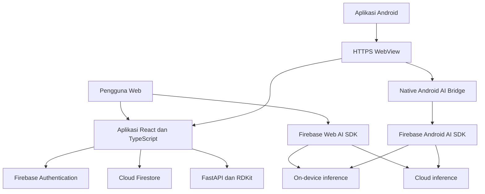

<div align="center">


# El-Kīmiyā

**Understand Chemistry. Anywhere.**

Platform pembelajaran kimia berbasis Hybrid AI untuk Web dan Android.

**Bahasa Indonesia** | [English](README.en.md)

[](https://el-kimiya.vercel.app/)
[](https://firebase.google.com/)

[](LICENSE)

**[Buka aplikasi](https://el-kimiya.vercel.app/) · [Galeri screenshot](docs/screenshots/README.md) · [Panduan Android](android/README.md)**

</div>

---

## Tentang El-Kīmiyā

El-Kīmiyā merupakan platform pembelajaran kimia yang memadukan materi bilingual, tutor AI, eksplorasi unsur, visualisasi molekul, latihan terstruktur, serta pengelolaan konten pembelajaran dalam satu ruang belajar.

Proyek ini dikembangkan untuk membantu pelajar memahami konsep kimia secara kontekstual, bukan sekadar menghafal rumus.

### Permasalahan

- Konsep kimia dan struktur molekul sulit dipahami melalui teks saja.
- Materi, latihan, referensi, dan tutor sering berada di platform berbeda.
- Koneksi internet dan kemampuan perangkat pengguna tidak selalu sama.
- Pembelajaran membutuhkan penjelasan yang interaktif dan transparan.

### Solusi

El-Kīmiyā menggabungkan Firebase AI Logic Hybrid Inference dengan pengalaman belajar interaktif yang mendukung pemrosesan AI lokal maupun cloud, sesuai kemampuan perangkat dan preferensi pengguna.

## Fitur utama

| Fitur | Deskripsi |
|---|---|
| AI Chemistry Tutor | Penjelasan kimia interaktif dengan respons AI dan notasi matematika. |
| Hybrid AI Engine | Pemilihan inferensi lokal atau cloud serta verifikasi penyedia aktual dari SDK. |
| My Library | 13 materi pembelajaran orisinal dalam Bahasa Indonesia dan Inggris, serta materi tambahan dari Moduler. |
| Book Reader | Pembacaan materi dan PDF pribadi yang dipilih pengguna. |
| Scan | Alur pembelajaran melalui gambar atau pemindaian materi. |
| Chemistry Explorer | Eksplorasi interaktif 118 unsur tabel periodik. |
| Molecular Intelligence Lab | Perakitan struktur molekul, validasi RDKit, dan visualisasi 2D/3D. |
| Practice Lab | 1.152 variasi perhitungan terstruktur dalam 12 kompetensi, dengan pemeriksaan jawaban. |
| Flashcards | Pembelajaran dan pengulangan konsep menggunakan kartu hafalan. |
| Research Mission | Alur eksplorasi dan pembelajaran ilmiah. |
| Chemistry & Faith | Pembelajaran kontekstual dengan pemisahan antara penjelasan ilmiah dan refleksi keagamaan. |
| Learning Progress | Pelacakan progres pembelajaran dan catatan. |
| Moduler Studio | Pengelolaan materi, soal, kartu hafalan, referensi, molekul, dan panduan tutor. |

## Hybrid AI — Firebase AI Logic

El-Kīmiyā menyediakan empat preferensi inferensi:

1. Prefer on-device.
2. On-device only.
3. Prefer cloud.
4. Cloud only.

Pada browser, permintaan AI menggunakan Firebase Web SDK. Pada aplikasi Android, permintaan AI dari WebView diteruskan melalui bridge ke Firebase AI Logic Android SDK native.

Hasil inferensi menampilkan sumber yang dilaporkan SDK:

- `ON_DEVICE`: inferensi dilakukan pada perangkat.
- `IN_CLOUD`: inferensi dilakukan melalui cloud.

Skenario simulasi pada halaman Hybrid AI merupakan ilustrasi pembelajaran, bukan bukti inferensi aktual.

Dukungan inferensi lokal bergantung pada kompatibilitas perangkat dan ketersediaan model. Mode lokal saja tidak diam-diam berpindah ke cloud.

### Bukti inferensi

| Web | Android |
|---|---|
| [Verifikasi cloud](docs/screenshots/README.md#web) | [Verifikasi on-device](docs/screenshots/android/06-hybrid-on-device-verification.png) |
| [Respons AI Tutor cloud](docs/screenshots/README.md#web) | [Verifikasi cloud](docs/screenshots/android/08-hybrid-cloud-verification.png) |
| | [Respons AI Tutor lokal](docs/screenshots/android/07-ai-tutor-on-device-response.png) |
| | [Respons AI Tutor cloud](docs/screenshots/android/09-ai-tutor-cloud-response.png) |

## Tampilan Android

<div align="center">


</div>

[Galeri lengkap Web dan Android](docs/screenshots/README.md).

## Peran pengguna

### Learner

Mengakses ruang belajar, materi, tutor AI, laboratorium, latihan, catatan, dan progres.

### Moduler

Membuat dan mengelola konten pembelajaran bilingual melalui Content Studio. Materi yang diterbitkan dapat diakses oleh Learner.

Perubahan panduan tutor oleh Moduler bersifat instruksi tambahan untuk pembelajaran, bukan pelatihan ulang model AI atau pengubahan model inferensi.

Otorisasi data menggunakan Firebase Authentication dan Firestore Security Rules. Pemberian peran Moduler dilakukan oleh pengelola Firebase yang berwenang.

## Arsitektur sistem



Firebase App Check membantu melindungi akses ke layanan Firebase.

## Teknologi

- React, TypeScript, Vite, Tailwind CSS.
- Firebase AI Logic, Authentication, Firestore, App Check.
- Kotlin, Jetpack Compose, Android WebView.
- Python, FastAPI, RDKit.
- PDF.js, Markdown, KaTeX.
- Vercel untuk deployment web.

## Menjalankan Web secara lokal

Prasyarat: Git, Node.js 22.13+ atau versi 24, dan npm.

```powershell
git clone https://github.com/MENSTRUE/el-kimiya.git
cd el-kimiya

npm ci
Copy-Item .env.example .env

npm run dev
```

Isi `.env` menggunakan konfigurasi Firebase Web milik proyek sendiri sebelum menguji AI dan autentikasi.

Untuk memeriksa build:

```powershell
npm run typecheck
npm run build
npm run preview
```

Backend RDKit publik menggunakan Vercel Python Function pada `/api/chemistry`. Server Vite biasa tidak menjalankan fungsi Python tersebut.

Panduan backend: [Vercel Python dan RDKit](docs/V49_VERCEL_PYTHON_ID.md).

## Konfigurasi Firebase

1. Buat proyek Firebase dan daftarkan aplikasi Web.
2. Aktifkan Authentication dengan Email/Password.
3. Aktifkan Firestore dan Firebase AI Logic.
4. Konfigurasikan App Check sesuai provider yang digunakan.
5. Tambahkan domain deployment ke konfigurasi domain yang sesuai.
6. Isi variabel dari `.env.example`.
7. Tinjau `firestore-v8.rules` sebelum menerapkannya.
8. Untuk menguji Moduler, pemilik proyek menetapkan dokumen `v8Roles/{uid}` dengan field `role` bernilai `moduler`.

Jangan menonaktifkan App Check untuk mengatasi kegagalan inferensi.

## Menjalankan Android

Gunakan Android Studio, JDK 17, Android SDK 36, dan konfigurasi Firebase Android sendiri.

Package: `com.menstrue.elkimiya`.

Aplikasi Android menggunakan tampilan web produksi melalui WebView, dengan integrasi AI melalui SDK Android native.

Panduan lengkap: [Android README](android/README.md).

## Pengujian

```powershell
npm ci
npm run typecheck
npm run build
node scripts/check-v82.cjs
node scripts/check-v83.cjs
node --test scripts/test-studio85.mjs scripts/test-rich-answer85.mjs scripts/qa-v85/test-visual-v85.mjs
```

Pengujian yang telah didokumentasikan pada 28 November 2026 mencakup respons AI cloud pada web, inferensi lokal dan cloud Android, penerbitan materi Moduler yang terlihat oleh Learner, tabel periodik, serta perakitan dan viewer molekul layar penuh.

Dokumentasi Android terdiri dari 17 screenshot dari pengujian pada perangkat Samsung SM-S948B.

Bukti screenshot bukan sertifikasi bahwa seluruh kombinasi perangkat, bahasa, tema, jaringan, dan skenario regresi selalu lulus.

## Privasi, keamanan, dan batasan

- PDF pribadi dan indeks sumber lokal tidak didistribusikan dalam repositori.
- Permintaan cloud mengirimkan masukan yang diperlukan kepada layanan AI.
- Inferensi lokal memerlukan perangkat dan model yang kompatibel.
- Data pembelajaran yang tersimpan lokal bukan sinkronisasi cloud otomatis.
- Hasil AI dapat keliru dan perlu diverifikasi dengan sumber ilmiah.
- Deskriptor RDKit bukan hasil pengukuran laboratorium.
- Bank soal numerik merupakan variasi terstruktur, bukan ribuan konsep independen.
- Distribusi Android publik memerlukan konfigurasi release signing dan Play Integrity yang sesuai.

Jangan mengunggah token App Check, kredensial, data akun pribadi, `.env`, `google-services.json`, atau PDF berhak cipta tanpa izin.

## BuildHybridAI 2026

Pengembangan El-Kīmiyā mencakup perluasan integrasi hybrid AI aktual, penyatuan ruang belajar Web dan Android, perbaikan antarmuka mobile, penambahan Content Studio, serta dokumentasi verifikasi inferensi melalui SDK.

Tujuannya adalah menghadirkan pembelajaran kimia yang adaptif terhadap kemampuan perangkat dan konektivitas pengguna.

## Lisensi

Kode sumber orisinal El-Kīmiyā menggunakan [Apache License 2.0](LICENSE).

Buku, dataset, merek, dan sumber pihak ketiga mengikuti ketentuan lisensinya masing-masing.

---

<div align="center">

**El-Kīmiyā — Understand Chemistry. Anywhere.**

[English documentation](README.en.md)

</div>